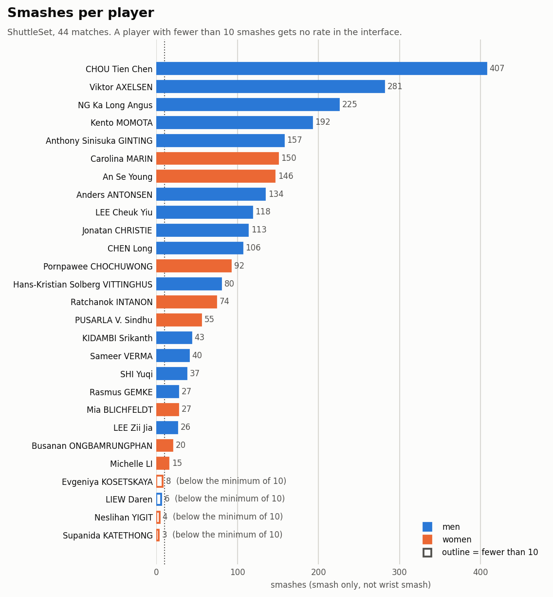
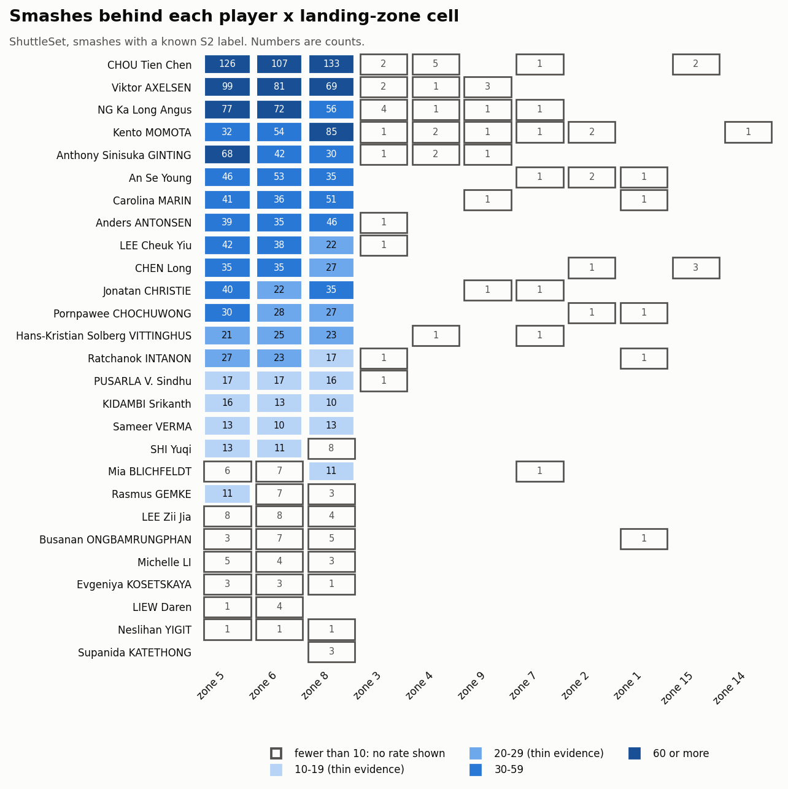
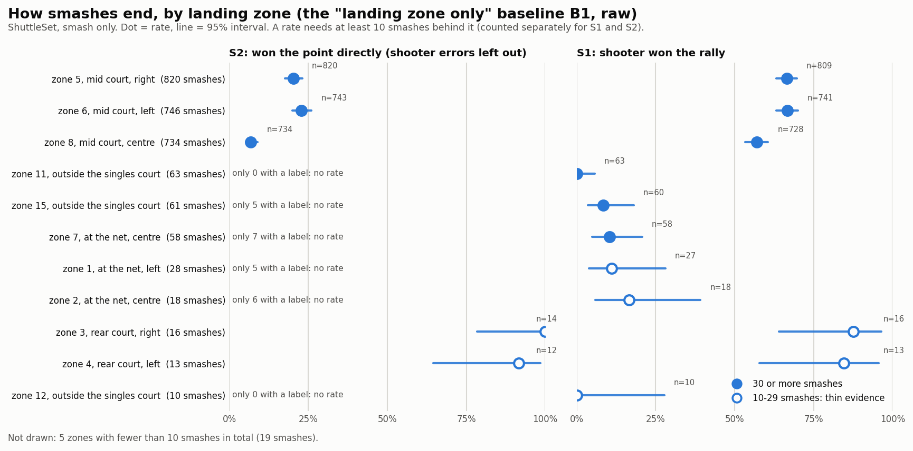
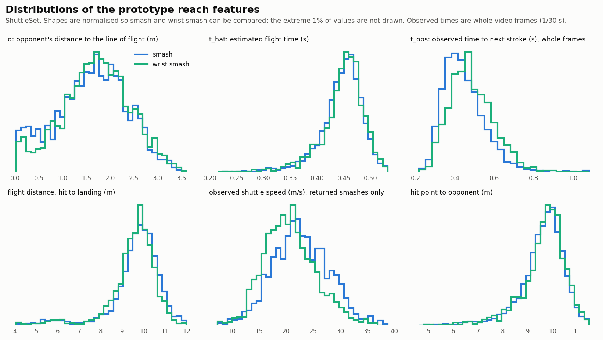
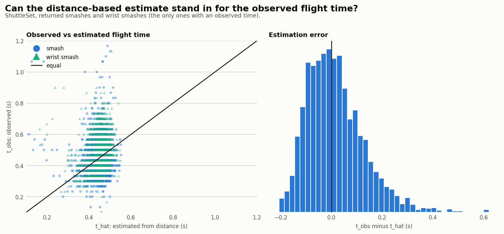
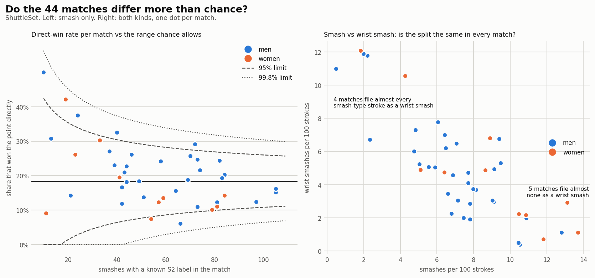
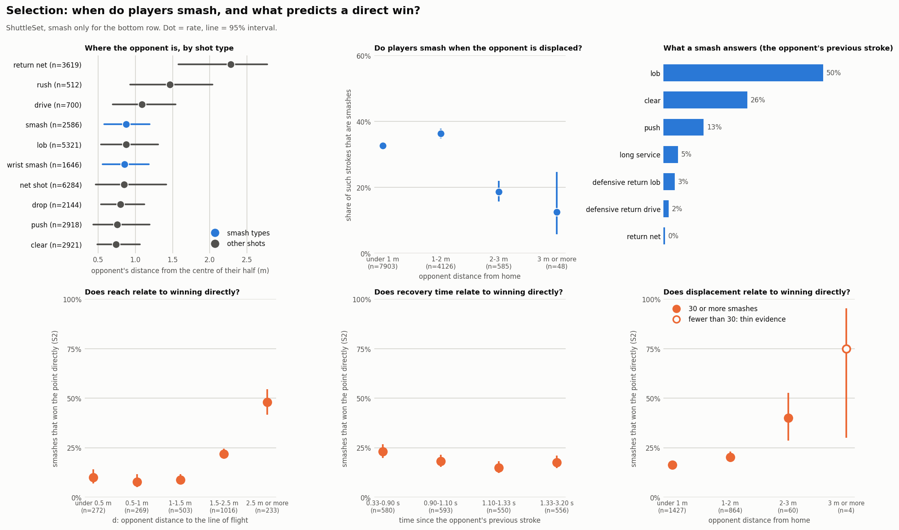

# How to read the EDA charts

This guide explains every chart produced by `EDA/eda_all.py`: the question each one answers, how to read each mark, the numbers behind it, and what to be careful about. Charts 1 to 7 describe the **training data** (ShuttleSet, 44 matches, in `EDA/all_matches/`). Chart 8 describes the **test data** (ShuttleSet22, 50 matches, in `EDA/test_set/`) without looking at any outcome.

Every number below is taken from the generated tables (`EDA/all_matches/*.csv`, `eda_report.md`), so it can be checked against them.

---

## 0. Terms used in the charts

| Term | Meaning |
|---|---|
| **Smash / wrist smash** | Two shot types in the data. Charts say "smash only" when wrist smashes are left out. "Smash-type" means both kinds together. |
| **S2, "won the point directly"** | 1 if the smash was the last stroke and the shooter won the rally with it. 0 if the opponent returned it. **Shooter errors (out, into the net) have no S2 value and are left out**, so S2 is a rate among smashes that were either won directly or returned. Overall: 18.4% of 2,355 labelled smashes. |
| **S1, "shooter won the rally"** | 1 if the shooter eventually won the rally, whatever happened after the smash. Overall: 58.5% of 2,561 labelled smashes. |
| **Shooter error** | The smash itself ended the rally against the shooter (out, into the net, fault). 8.8% of smashes. |
| **Landing zone** | A numbered grid cell on the opponent's half. Zones 5, 6 and 8 are the three mid-court lanes (right, left, centre). Zones 1, 2, 7 are at the net line. Zones 3, 4, 9 are the rear court. Zones 10 to 16 are outside the singles court. |
| **`d`** | The opponent's distance (metres) from the line the shuttle flies along (the straight line from the hit point to the landing point). Small `d` means the shot went at the opponent. Large `d` means it went away from them. |
| **`t_obs`** | Observed time from the smash to the opponent's next stroke. Only exists for smashes that were returned. |
| **`t_hat`** | Estimated flight time: the distance from the hit point to the opponent divided by the median shuttle speed (21.6 m/s). Known without the next stroke. |
| **"Home"** | The centre of the opponent's half of the court. "Opponent distance from home" measures how far out of their usual position they stand when the smash is hit. |
| **Minimum count of 10** | A rate is shown only when at least 10 smashes are behind it. **Thin evidence** means 10 to 29 smashes: the rate is shown but drawn as a hollow dot or a light colour. |
| **95% interval** | The range of true rates that is consistent with the observed count. It is wide when few smashes are behind a rate. |

**Reading rules used in every chart:**
1. A **hollow** mark means "not enough data" (under 10) or "thin evidence" (10 to 29), depending on the legend.
2. A **line through a dot** is a 95% interval. If two dots' lines overlap a lot, the difference between them is not reliable.
3. Colours follow one rule per chart: blue and orange for men and women, or for training and test, or for two groups being compared, always named in a legend.

---

## 1. Smashes per player: `all_matches/counts_per_player.png`



**Question:** how many smashes do we have for each player?

**How to read it:** one horizontal bar per player, sorted by smash count. Blue is men, orange is women. The number at the end of the bar is the count. The dotted vertical line marks 10. A **hollow bar** means fewer than 10.

**What it shows:**
- Counts range from 407 (Chou Tien Chen) to 3 (Supanida Katethong). The median player has 74.
- The top five are all men: Chou Tien Chen 407, Viktor Axelsen 281, Ng Ka Long Angus 225, Kento Momota 192, Anthony Ginting 157. The best-represented woman is Carolina Marin (150).
- **Four players are below 10** and get no rate: Kosetskaya (8), Liew Daren (6), Neslihan Yigit (4), Katethong (3). Nine players are below 30.
- Women contribute 594 of 2,586 smashes (23%).

**What to be careful about:** only smashes count here, not wrist smashes. A player's count reflects how many of their matches are in the data (the dataset has 44 matches), not how often they smash.

**Why it matters:** player-level rates are trustworthy for most players but not all. This is the reason for the minimum count.

Table: `counts_per_player.csv`.

---

## 2. Smashes in each player × landing-zone cell: `all_matches/counts_player_zone.png`



**Question:** if we split smashes by player and by where they landed, how many cells have enough data to show a rate?

**How to read it:** rows are players (most smashes at the top), columns are landing zones (most smashes on the left). Each box holds the number of smashes in that cell. Only smashes with an S2 label are counted.
- Dark blue: 60 or more. Medium blue: 30 to 59.
- The two lightest blues (10 to 19 and 20 to 29): enough for a rate, but **thin evidence**.
- A **hollow grey box with a number**: fewer than 10, so no rate.
- Blank: no smashes.

**What it shows:**
- There are 118 non-empty cells. **55 reach 10 smashes** (covering 93% of the labelled smashes) and **31 reach 30**. The typical cell holds just 7 smashes.
- Nearly all the data is in the first three columns, zones 5, 6 and 8. The player who dominates is Chou Tien Chen (126, 107 and 133 smashes in those zones).
- Players near the bottom of the chart have hollow boxes in almost every cell, so the interface can show nothing for them at zone level.

**What to be careful about:** a player with 100 smashes can still have only 5 in a particular zone. The table `counts_player_zone.csv` lists every cell.

**Why it matters:** this is the picture behind the "uncertainty must be visible" argument. Most player × zone numbers rest on very few smashes.

---

## 3. How smashes end, by landing zone: `all_matches/outcome_rates_by_zone.png`



**Question:** if you only knew where a smash landed, how often would it win? This is the baseline **B1** (landing zone only), in raw form with no model.

**How to read it:** two panels sharing the same rows (landing zones, with the region and the number of smashes). Left panel: S2 (won the point directly). Right panel: S1 (shooter won the rally). A dot is the rate, the line is the 95% interval, a hollow dot is thin evidence (10 to 29). Text such as "only 5 with a label: no rate" means fewer than 10 smashes have that outcome label. The small `n=` above each dot is the number behind that rate. The note at the bottom says which zones are not drawn.

**What it shows:**

| Zone | Where | Smashes | S2 (won directly) | S1 (won rally) |
|---|---|---|---|---|
| 5 | mid court, right | 820 | 20.2% (17.6 to 23.1) | 66.5% |
| 6 | mid court, left | 746 | 22.9% (20.0 to 26.0) | 66.7% |
| 8 | mid court, centre | 734 | 6.8% (5.2 to 8.9) | 57.0% |
| 11, 15, 12 | outside the singles court | 63, 61, 10 | almost no labels | 0% to 8% |
| 7, 1, 2 | at the net | 58, 28, 18 | almost no labels | 10% to 17% |
| 3 | rear court, right | 16 | 100% of 14 (thin) | 88% |
| 4 | rear court, left | 13 | 92% of 12 (thin) | 85% |

- **The three mid-court lanes hold 89% of all smashes** (2,300 of 2,586). Going down the centre (zone 8) wins directly only 7% of the time, against about 20% to 23% for the side lanes.
- **Landing outside the singles court**, or **at the net line**, are almost always errors. 145 smashes (5.6%) landed outside the court and 94% of them are recorded as shooter errors. 104 landed at the net line and 82% are shooter errors. That is why those rows have almost no S2 labels (errors are left out of S2) and a low S1.
- Zones 3 and 4 (rear court corners) win directly almost every time, but only 16 and 13 smashes landed there.

**What to be careful about:** S2 leaves out shooter errors, so "100%" in a rear corner means "of the few that were either won or returned", not "of all smashes aimed there". Rates for different zones are not comparable unless you also look at the error rate.

**Why it matters:** landing zone alone already explains a lot. The reach features (`d`, time) only count as a finding if they add something beyond this.

Table: `outcome_rates_by_zone.csv`.

---

## 4. Distributions of the reach features: `all_matches/distributions_reach_features.png`



**Question:** how are the prototype reach measures spread out, and do smashes and wrist smashes differ?

**How to read it:** six small panels, each a histogram drawn as an outline. Blue is smash, green is wrist smash. The shapes are **normalised** (each outline has the same area) so the two kinds can be compared even though there are more smashes. The extreme 1% of values are not drawn.

| Panel | Smash median (middle half) | What it shows |
|---|---|---|
| `d`: opponent's distance to the line of flight | 1.66 m (1.09 to 2.14) | A wide spread. Many shots are within 1 m of the opponent, others 2.5 m or more away. Smash and wrist smash look alike. |
| `t_hat`: estimated flight time | 0.45 s (0.43 to 0.47) | A very narrow spike. |
| `t_obs`: observed time to the next stroke | 0.43 s (0.37 to 0.50) | Broader, with a stepped outline because times are whole video frames (1/30 s = 0.033 s). |
| Flight distance, hit to landing | 9.84 m (9.28 to 10.35) | Nearly every smash travels about 10 m. |
| Observed shuttle speed | 22.5 m/s (19.1 to 26.4) | Wrist smashes are slower: median 20.5 m/s. |
| Hit point to opponent | 9.74 m (9.20 to 10.18) | Also nearly constant. |

**Why it matters:** `d` varies a lot between smashes, but the time measures built from distance do not, because almost every smash covers about the same distance. This is the reason chart 5 exists.

Tables: `distributions_reach_features.csv` (mean, spread and percentiles for each feature and shot type).

---

## 5. Observed against estimated flight time: `all_matches/t_obs_vs_t_hat.png`



**Question:** can the distance-based estimate (`t_hat`) stand in for the observed time to the opponent's next stroke (`t_obs`)?

**How to read it:**
- **Left panel:** each dot is a returned smash (blue) or wrist smash (green). The horizontal position is the estimate and the vertical position is what was observed. The black line is "equal": a perfect estimate would put every dot on it. The horizontal stripes are the video frames.
- **Right panel:** a histogram of the error (observed minus estimated). Zero is a perfect estimate.

**What it shows:**
- The dots form a **flat band**, not a line. The estimate stays between about 0.37 and 0.50 s for 90% of strokes, while observed times range much more widely (0.30 to 0.63 s for 90% of strokes, with some over 1 s).
- **Correlation 0.09** (0.14 if speed is set per shot type). The average error is 0.092 s, and 65% of estimates are within 0.10 s, simply because both numbers sit near 0.45 s.
- The spread of `t_hat` is 0.043 s (10% of its mean) against 0.127 s (27%) for `t_obs`.
- The error is centred on zero (median 0.001 s) but has a long right tail: some returns come much later than the shuttle's flight time suggests (18 of 3,225 observed times exceed 1.0 s).

**What to be careful about:** `t_obs` is the time to the opponent's *stroke*, not the shuttle's arrival. It includes the opponent's reaction and swing, and it is rounded to whole frames, so part of its spread is timing noise.

**Why it matters:** `t_hat` carries almost no information. The "reach slack" `s = v·t − d` therefore behaves like `−d` plus a constant. This is why the plan recommends a different "time available" measure (the time since the opponent's previous stroke).

Tables: `t_obs_vs_t_hat_summary.csv`, `t_obs_vs_t_hat_outliers.csv` (the 25 largest gaps, with match, set and rally).

---

## 6. Do the matches differ more than chance? `all_matches/match_heterogeneity.png`



**Question:** are the 44 matches alike, or do they differ in ways that chance cannot explain?

### Left panel: a funnel plot of the direct-win rate

**How to read it:** each dot is one match (blue men, orange women) with at least 10 labelled smashes. The horizontal axis is how many smashes it has, and the vertical axis is the share that won the point directly. The solid black line is the overall rate (18.4%). The **dashed curves** are the 95% limits and the **dotted curves** the 99.8% limits: the range that chance alone would produce around the overall rate. The curves are wide on the left (few smashes) and narrow on the right. A match **outside** the curves differs from the others by more than luck.

**What it shows:** seven of 42 matches fall outside the 95% limits, where about 2 would be expected by chance. The statistical test gives dispersion 1.98 (chi-square 81 on 41 degrees of freedom, p = 0.0002): the spread between matches is about twice what luck would give. Women's matches have a lower median direct-win rate (13.6% against 20.2% for men).

**Why it matters:** matches really differ (the players, the tournament, the style, and also how the annotator worked). The model needs a match effect, or at least intervals that treat the match as the unit.

### Right panel: smash against wrist smash per match

**How to read it:** each dot is a match. The horizontal axis is smashes per 100 strokes and the vertical axis is wrist smashes per 100 strokes. The two notes mark the extreme corners.

**What it shows:** a clear **trade-off line**. In some matches nearly every smash-type stroke is recorded as a wrist smash (top left) and in others almost none (bottom right).
- The wrist-smash share of smash-type strokes has a median of 36%, a middle half of 24% to 49%, and a range of **4% to 96%**.
- Smash-type strokes **together** are steady: a median of 12.1 per 100 strokes, with the middle half between 10.9 and 13.8.
- Four matches record 84% to 96% as wrist smashes: Antonsen v Christie (96% of 117), Marin v Katethong (87% of 84), Axelsen v Liew (86% of 77), Axelsen v Christie (84% of 89). Five record only 4% to 8%.
- Even so, within the same match smashes win directly more often than wrist smashes in **36 of 41 matches** (median +12.9 points), so the two kinds do differ. The match-level link between the wrist-smash share and the overall direct-win rate is weak (rank correlation −0.07).

**What to be careful about:** the data has no annotator id, so "depends on who labelled the match" is an inference from the pattern, not a recorded fact.

**Why it matters:** the "smash only" definition is unreliable, because in some matches the real smashes are filed as wrist smashes. The plan therefore recommends using both kinds together with the kind as a feature.

Tables: `match_heterogeneity.csv` (one row per match, with robust outlier scores).

---

## 7. When do players smash, and what predicts a direct win? `all_matches/selection_effect.png`



**Question:** this chart addresses the professor's *selection* point (players choose when to smash) and gives a first look at whether reach relates to winning. It has six panels in two rows.

**"Home"** is the centre of the opponent's half (3.05 m across the court, 3.35 m beyond the net). Opponent position is taken at the moment of the hit.

### Top row: when do players smash?

**Top left: where the opponent is, by shot type.** Each row is a shot type, the dot is the median distance of the opponent from home, and the line is the middle half. Blue is the smash types.
- Medians: return net 2.28 m, rush 1.46, drive 1.09, smash 0.88, lob 0.87, wrist smash 0.85, net shot 0.85, drop 0.80, push 0.76, clear 0.74.
- The opponent is about as close to home for a smash as for most shots. Only "return net" (2.28 m) and, less so, "rush" (1.46 m) stand out with the opponent further from the centre.

**Top middle: do players smash when the opponent is displaced?** Among 12,662 strokes hit from the back of the court at or above net height (the strokes where a smash is possible), the share that are smashes is:

| Opponent distance from home | Share that are smash-type | Strokes |
|---|---|---|
| under 1 m | 32.6% | 7,903 |
| 1 to 2 m | 36.3% | 4,126 |
| 2 to 3 m | 18.6% | 585 |
| 3 m or more | 12.5% | 48 |

So smashes are **not** more likely when the opponent is out of position. Most opponents are within 2 m of home (median 0.9 m).

**Top right: what a smash answers.** The bars give the share of smashes by the opponent's previous stroke (2,501 smashes): **lob 50%, clear 26%, push 13%, long service 5%**, defensive return lob 3.5%.
- So the real selection is "players smash a high shuttle", not "players smash when the opponent is stranded".

### Bottom row: what relates to winning directly (S2, smash only)

Each dot is a rate, each line a 95% interval, with the count under the label. A hollow dot is under 30 smashes.

**Bottom left: by `d`.** Direct-win rate: under 0.5 m 9.9% (272 smashes), 0.5 to 1 m 7.8% (269), 1 to 1.5 m 8.7% (503), 1.5 to 2.5 m 21.9% (1,016), **2.5 m or more 48.1%** (233). Going away from the opponent matters, and mostly beyond 1.5 m.

**Bottom middle: by time since the opponent's previous stroke.** 23.1% (shortest quarter, under 0.90 s), 18.2%, 14.9%, 17.6%. Only a weak pattern (rank correlation −0.07).

**Bottom right: by the opponent's distance from home.** 16.3% (1,427), 20.3% (864), 40.0% (60), 75% (only 4, hollow). A rise, but the last two groups have very few smashes.

**What to be careful about:**
- **These are associations, not tests.** `d` is partly tied to landing zone (side lanes make larger `d`).
- To check that, the rank correlation of `d` with S2 is +0.27 overall and **+0.27 within the three mid-court zones alone**, so `d` is not only a stand-in for the zone. The proper test is the model comparison in Phase 9.
- Directly-won smashes are the rarer outcome, so rates in thin groups jump around.

**Why it matters:** `d` looks like a useful predictor. The selection worry should be framed as "players smash after lobs and clears". The time measure from distance is useless, as chart 5 showed.

Tables: `selection_*.csv` (five files, one per panel).

---

## 8. The test set, described without outcomes: `test_set/test_set_overview.png`

> This chart and its tables are kept local (not in the repository), so no image is embedded here. They are produced by `EDA/eda_all.py` and contain **no outcome of any kind**: the loader removes every outcome column, and `EDA/test_eda.py` checks that no test table has one.

**Question:** is the test data similar enough to the training data in what a model would *see*, and who is in it?

**Left panel: smashes per player in the test matches.** Filled orange bars are players who also appear in ShuttleSet. **Outlined bars are players who do not**.
- The test set has 50 matches and 3,470 smashes. A player has between 14 and 328 smashes (median 85); no player is below 10.
- 16 of the 35 players are new. They hit **1,716 of the 3,470 smashes (49%)** and are the opponent in 1,749. In 14 test matches both players are known from training, in 25 only one, and in 11 neither.

**Middle panel: `d` in training (blue) and test (orange).** The two outlines nearly coincide. Median `d`: 1.66 m in training, 1.65 m in test.

**Right panel: landing-zone mix.** Paired bars for the eight most common zones: zone 5 31.7% vs 33.6%, zone 6 28.8% vs 31.2%, zone 8 28.4% vs 24.8%. The total difference between the two mixes is small (distance 0.05, where 0 means identical).

**Other facts from the tables** (`test_set/*.csv`):
- Other inputs are also close (standardised differences, where 0 is identical): `t_hat` −0.14, flight distance −0.11, hit-to-opponent distance −0.14, opponent distance from home +0.02.
- Women hit 42% of test smashes, against 23% in training.
- Positions are inside the court in at least 99.5% of strokes in every test match. One match (Chen Yu Fei v He Bing Jiao, Indonesia Masters 2022) has 27 rallies with unusable positions, flagged and excluded from position-based analysis. 5,488 of 5,608 smash-type strokes have usable reach inputs.

**What to be careful about:** this only compares *inputs*. It says nothing about whether outcomes are alike, because outcomes are deliberately not examined until the final test.

**Why it matters:** the test set looks like a fair test (similar inputs), but half of its smashes depend on how the model handles players it has never seen, and it has more women's matches than the training set.

---

## Summary of what the charts say, in order

1. Player-level data is thin for a few players (4 below 10); player × zone data is thin for most cells (only 55 of 118 reach 10).
2. Where a smash lands already explains a lot: the centre lane wins directly 7%, the side lanes 20% to 23%, and out-of-court or net-line landings are mostly errors.
3. Almost every smash travels about 10 m, so distance-based flight time has almost no spread and does not track the observed time (correlation 0.09).
4. `d` (distance from the opponent to the line of flight) varies a lot and relates to direct wins, also inside the main zones.
5. Matches differ more than chance, and the smash / wrist-smash split depends on the match (4% to 96% wrist).
6. Players smash after lobs and clears, not especially when the opponent is displaced.
7. The test set's inputs resemble the training set's, but half its smashes come from players not in training.

**Decisions these charts feed** (details in the plan):
- Use smash and wrist smash together as the main group, with the kind as a feature.
- Replace `t_hat` with the time since the opponent's previous stroke (and still report the original).
- Include a match effect in the model.

---

## Regenerating and checking

```
~/.venvs/shotscope/bin/python EDA/eda_all.py     # rewrites all charts, tables and eda_report.md
~/.venvs/shotscope/bin/python EDA/test_eda.py    # 17 checks, including that the test-set output has no outcomes
```

| Chart | Image | Table(s) |
|---|---|---|
| 1 | `all_matches/counts_per_player.png` | `counts_per_player.csv` |
| 2 | `all_matches/counts_player_zone.png` | `counts_player_zone.csv`, `counts_per_zone.csv` |
| 3 | `all_matches/outcome_rates_by_zone.png` | `outcome_rates_by_zone.csv` |
| 4 | `all_matches/distributions_reach_features.png` | `distributions_reach_features.csv` |
| 5 | `all_matches/t_obs_vs_t_hat.png` | `t_obs_vs_t_hat_summary.csv`, `t_obs_vs_t_hat_outliers.csv` |
| 6 | `all_matches/match_heterogeneity.png` | `match_heterogeneity.csv` |
| 7 | `all_matches/selection_effect.png` | `selection_opponent_distance_by_type.csv`, `selection_smash_propensity.csv`, `selection_preceding_stroke.csv`, `selection_S2_by_opponent_position.csv` |
| 8 | `test_set/test_set_overview.png` | `test_set/shift_check_inputs.csv`, `shift_check_landing_zone_mix.csv`, `test_counts_per_player.csv`, `test_match_quality.csv` |
